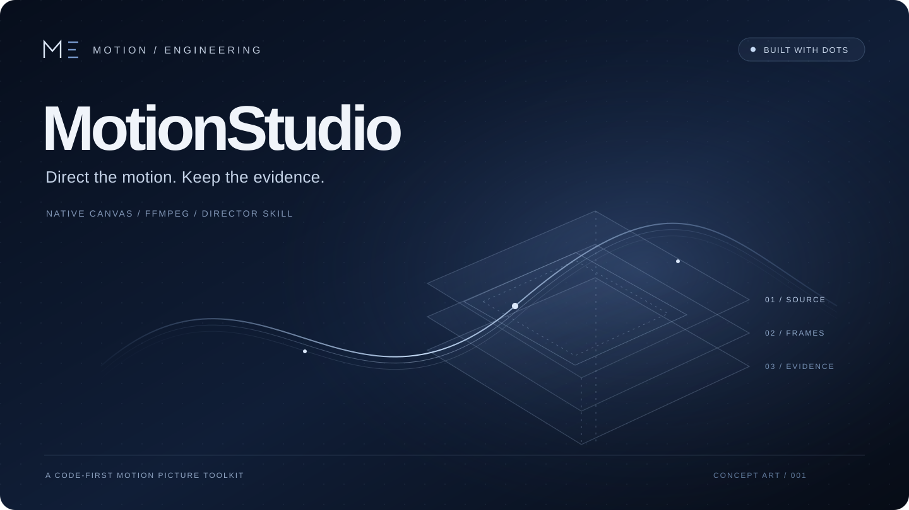
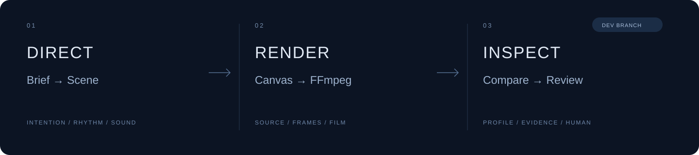

<div align="center">



# 用代码构建镜头，用证据推进创作。

**A code-first motion picture toolkit.**

从导演意图、原生 Canvas 场景，到 FFmpeg 成片与视听复核。<br />
MotionStudio 把可编辑的制作过程，留在每一帧背后。


<a href="https://github.com/doomclouds/MotionStudio/tree/dev"></a>
<a href="#许可与素材"></a>

[快速开始](#快速开始) · [工作方式](#工作方式) · [开发中的审查工具](#开发中的审查工具) · [项目地图](#项目地图)

</div>

> **正在 `dev` 开发。** `main` 保留稳定的原生渲染核心与导演 Skill；新的视听对照、内容证据校验在 [`dev`](https://github.com/doomclouds/MotionStudio/tree/dev)。上方为原创概念图，不是软件界面或成片截图。

## 不止生成画面，更要掌握制作过程

好的动效不只是“动起来”。它需要明确的意图、可控的节奏、可信的素材，以及能解释下一次修改的证据。

MotionStudio 是一个**源码优先的影片制作工具集**，不是时间轴编辑器，也不是一键审美评分器。它将导演流程、原生渲染和审查工具放进同一个工程，让创作能继续修改，也能回头追溯。

<table>
<tr>
<td width="33%" valign="top">

### 01 · 镜头可编程

以绝对时间驱动 Canvas 场景。构图、字形、转场与节奏写在源码里，而不是藏在不可编辑的导出文件中。

</td>
<td width="33%" valign="top">

### 02 · 生产链轻量

Node.js + Native Canvas 输出 PNG 帧，再由 FFmpeg 编码。生产核心不依赖浏览器、CDP 或 GSAP。

</td>
<td width="33%" valign="top">

### 03 · 修改有依据

保留源码与媒体身份；在 `dev` 中，以同 schema 对照视听特征，把人工观察连接到时间窗与证据。

</td>
</tr>
</table>

## 工作方式



**Director Skill** 整理脚本、美术、运动、声音与迭代方法；**Native Core** 把场景变成可核验的帧；**Review Tools** 帮助定位差异、整理证据，而不是替创作者决定什么叫好看。

- **创作可继续：** 场景、依赖与项目配置保留为可编辑源码。
- **输出可追溯：** 渲染指纹记录声明的源码、配置与运行环境；不承诺跨平台像素完全一致。
- **判断有边界：** 技术检查、实际观看／听审、用户认可分别记录，不把“运行成功”写成“作品通过”。

## 快速开始

### 1. 获取源码与运行环境

需要 **Node.js ≥ 24**、**Python 3**（打包和检查工具）以及可用的 **FFmpeg / ffprobe**。下面的视频示例还需要 FFmpeg 的 `libx264` 编码器。

```bash
git clone https://github.com/doomclouds/MotionStudio.git
cd MotionStudio

# 主动安装原生 Canvas 依赖；渲染过程不会自动安装或下载
cd engine/motion-render-core
npm install --ignore-scripts
node --test test/native.test.mjs
cd ../..
```

直接依赖固定为 `@napi-rs/canvas@0.1.100`；当前没有完整 lockfile，不代表整套环境已锁定。已有依赖也可通过 `MOTIONSTUDIO_CANVAS_MODULE` 指定，详见[运行环境与 Scene API](engine/motion-render-core/README.md)。

### 2. 渲染第一个技术样例

在仓库根目录运行；把工作目录换成仓库外的**全新绝对路径**：

```bash
node skills/motion-film-director/scripts/render-shot.mjs \
  --scene "$PWD/engine/motion-render-core/fixture/native-scene.mjs" \
  --work /absolute/path/outside-repository/my-first-motion
```

将生成 `output/shot.mp4`、PNG 帧与技术报告。内置夹具是 **1 秒、320 × 180、30 fps 的静音技术样例**，用于验证管线，不是作品展示。已有输出不会被静默覆盖。

### 3. 从样例走向作品

阅读 [Scene API](engine/motion-render-core/README.md) 与[导演 Skill](skills/motion-film-director/SKILL.md)，建立自己的场景、声明素材依赖，并为每次迭代使用独立工作目录。

<details>
<summary><strong>导出可移植的导演 Skill</strong></summary>

```bash
python3 scripts/build-skill.py \
  --output /absolute/path/outside-repository/motion-film-director.zip
```

请在已提交、干净的恢复目录中构建。打包器以 Git 索引列出的 Skill 和核心源码为范围，读取当前文件字节，加入原生 runtime 快照及校验清单。新建但未进入索引的文件不会自动进入包。

可移植 Skill **不包含完整仓库中的视听对照与审查 CLI**。法律说明及依赖署名必须随实际分发内容保留。

</details>

## 开发中的审查工具

以下入口均指向 **`dev` 分支**；先运行 `git switch dev`。它们是本地诊断与证据整理工具，不是自动导演，也不是成片验收服务。

### A / B · 用相同的格式看见差异

[Reference Benchmark](https://github.com/doomclouds/MotionStudio/tree/dev/tools/reference-benchmark) 将参考片与候选片导出为**同一 profile schema**，按原始时间轴对照视觉、运动与音频特征。

| 观察维度 | 工具提供什么 |
| :--- | :--- |
| 画面 | 时间轴、缩略图、色彩／明暗／纹理代理、局部结构诊断 |
| 运动 | 采样帧差、稀疏块匹配与显式不确定性 |
| 声音 | 波形、响度／真峰、log-mel、onset／tempo 候选 |
| 对照交付 | 中文 HTML、overview、两份 profile、comparison 与文件 hash 清单 |

模块默认离线运行，不上传媒体、不下载模型权重、不调用付费模型。需要 Python 3.12+、NumPy、SciPy、Pillow 及相应 FFmpeg 能力；安装与完整命令见 [模块说明](https://github.com/doomclouds/MotionStudio/blob/dev/tools/reference-benchmark/README.md)。

**指标帮助定位问题，不等于听过、看懂或喜欢。** 结构相似度不是质量分，节拍候选不是音效识别，对齐假设不是音画同步验收。

### Evidence / Review · 让判断找到它的依据

[内容审查校验器](https://github.com/doomclouds/MotionStudio/blob/dev/tools/reference-benchmark/CONTENT_REVIEW.md) 检查人工提交的注释：引用是否完整、媒体 SHA-256 是否一致、时间窗是否有效，以及计划或虚构内容是否被当成真实观察。

```text
创作目标 → 人工观察 → 媒体 hash + 时间窗 → 修改假设 → 复验记录
```

它**不识别视频内容，不核实注释本身的真实性，不给影片自动打分**。通过校验只说明证据结构满足契约；艺术判断与最终认可仍属于观看者和创作者。

<details>
<summary><strong>审查与测试入口</strong></summary>

- [引导式成片自审](https://github.com/doomclouds/MotionStudio/blob/dev/skills/motion-film-director/references/guided-self-review.md)：先明确目标，再选择方法与反证。
- [可选原生音频审查](https://github.com/doomclouds/MotionStudio/blob/dev/scripts/AUDIO-REVIEW.md)：默认本地 dry run；实际上传、联网调用与预算需要单独授权。

```bash
# 在 dev 分支、所需依赖已就绪时运行
python3 -m unittest discover -s tools/reference-benchmark -p 'test_*.py' -v
node tools/reference-benchmark/test_report_js.cjs
```

测试验证实现与边界，不证明某部电影已经过审。

</details>

## 项目地图

| 入口 | 内容 | 分支 |
| :--- | :--- | :--- |
| [`engine/motion-render-core/`](engine/motion-render-core/) | 唯一维护的原生渲染核心、夹具与测试 | `main` / `dev` |
| [`skills/motion-film-director/`](skills/motion-film-director/) | 导演工作流、知识参考、渲染入口与权利说明 | `main` / `dev` |
| [`scripts/build-skill.py`](scripts/build-skill.py) | 可移植 Skill 打包 | `main` / `dev` |
| [`tools/reference-benchmark/`](https://github.com/doomclouds/MotionStudio/tree/dev/tools/reference-benchmark) | 同格式视听对照、报告与内容证据校验 | `dev` |
| [`scripts/review_film.py`](https://github.com/doomclouds/MotionStudio/blob/dev/scripts/review_film.py) | 引导式自审计划与本地技术检查 | `dev` |

项目影片工程、私有研究库、素材索引与评审记录不在此公开工具集内。原始私有工作区保留不动；本仓库可直接运行的是上述技术夹具，不宣称发布全部影片项目。详见 [SOURCE-SCOPE.md](SOURCE-SCOPE.md)。

## 一起推进

欢迎围绕**最小可复现场景、明确的运行环境、预期与实际差异**提交 [Issue](https://github.com/doomclouds/MotionStudio/issues) 或 [Pull Request](https://github.com/doomclouds/MotionStudio/pulls)。功能开发以 `dev` 为目标分支。

提交前请运行相关测试，不要提交 `node_modules`、渲染帧、成片、调试报告、私有参考媒体或凭据。素材不能仅凭扩展名判断可否分发：请保留来源、许可与必要署名。

## 许可与素材

原创代码采用 [MIT License](LICENSE)。**MIT 不自动覆盖第三方字体、音乐、图像、商标、参考艺术或历史来源代码**；请遵循各目录实际适用的许可与声明：

- [公开分发与第三方素材总览](THIRD_PARTY_NOTICES.md)
- [原生核心 NOTICE](engine/motion-render-core/NOTICE.md)
- [导演 Skill NOTICE](skills/motion-film-director/NOTICE.md)
- [素材与参考权利边界](skills/motion-film-director/RIGHTS.md)

私人研究或技术验证不等于公开发行授权。

---

<div align="center">

**Built with Dots. Made for the next iteration.**

<sub>MotionStudio · 把想法变成镜头，把修改落在证据上。</sub>

</div>
