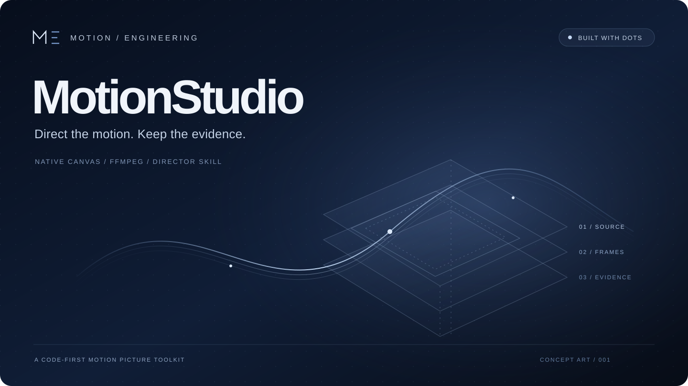
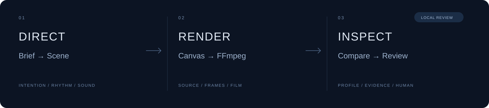
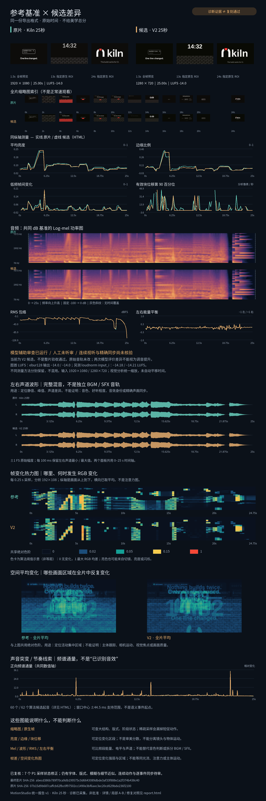

<div align="center">



# 用代码构建镜头，用证据推进创作。

**A code-first motion picture toolkit.**

从导演意图、原生 Canvas 场景，到 FFmpeg 成片与视听复核。<br />
MotionStudio 把可编辑的制作过程，留在每一帧背后。


<a href="#许可与素材"></a>

[快速开始](#快速开始) · [工作方式](#工作方式) · [动效积木与配方](#动效积木与配方) · [声音与证据](#声音与证据) · [开发中的审查工具](#开发中的审查工具) · [协作与规范](#协作与规范) · [项目地图](#项目地图)

</div>

> **以当前检出版本为准。** 本页描述与此 README 同版本的源码与入口，不表示任何远端分支、标签或发行包已发布这些变更。仓库内链接随当前版本解析；复现时记录实际 commit。上方为原创概念图，不是软件界面或成片截图。

## 不止生成画面，更要掌握制作过程

好的动效不只是“动起来”。它需要明确的意图、可控的节奏、可信的素材，以及能解释下一次修改的证据。

MotionStudio 是一个**源码优先的影片制作工具集**，不是时间轴编辑器，也不是一键审美评分器。它将导演流程、原生渲染和审查工具放进同一个工程，让创作能继续修改，也能回头追溯。

<table>
<tr>
<td width="33%" valign="top">

### 01 · 镜头可编程

以绝对时间驱动 Canvas 场景。构图、字形、转场与节奏写在源码里，而不是藏在不可编辑的导出文件中。

</td>
<td width="33%" valign="top">

### 02 · 生产链轻量

Node.js + Native Canvas 默认输出 PNG 帧，再由 FFmpeg 编码；可选顺序分块 PNG 流。生产核心不依赖浏览器、CDP 或 GSAP。

</td>
<td width="33%" valign="top">

### 03 · 修改有依据

保留源码与媒体身份；以同 schema 对照视听特征，把人工观察连接到时间窗与证据。

</td>
</tr>
</table>

## 工作方式



**Director Skill** 整理脚本、美术、运动、声音与迭代方法；**Native Core** 把场景变成可核验的帧；**Review Tools** 帮助定位差异、整理证据，而不是替创作者决定什么叫好看。

- **创作可继续：** 场景、依赖与项目配置保留为可编辑源码。
- **输出可追溯：** 渲染指纹记录声明的源码、配置与运行环境；不承诺跨平台像素完全一致。
- **判断有边界：** 技术检查、实际观看／听审、用户认可分别记录，不把“运行成功”写成“作品通过”。

## 可重渲染作品集

[Tessel · 33秒非官方Canvas2D复刻](portfolio/works/tessel/README.md)：保留必要源码、真实依赖锁、外置资源恢复方法、完整署名/许可及**唯一封面**，不带成片、帧序列、字体或音频。全1980帧源码恢复已核验；用户确认收录，视觉复核 `PARTIAL`、实际听审 `NOT_LISTENED`、声画同步 `NUMERIC_ONLY` 分开披露。维护用途为学习、研究与非商业展示，不改写MIT/OFL授权。

[Favorite52 · 52秒非官方复刻源码](portfolio/works/favorite52/README.md)：全部关键代码与16项必需资源清单/来源/hash已收录，唯一封面；图标、实际混音和精确字体需合法自备，不随Git公开。用原私人备份资源的公开入口已全长重渲，1560帧及最终MP4与喜欢的版本一致。标记为 `source-release`，不是无需自备素材的自动完整下载包。

保留与权利联系规范：[portfolio/README.md](portfolio/README.md)；实际作品清单：[portfolio/works/](portfolio/works/)。

## 快速开始

### 1. 一次安装，默认离线、无需密钥

当前仓库版本 **0.1.0**。基础视频需要 **Node.js ≥24** 和带 **libx264** 的 **FFmpeg / ffprobe**，请先通过自己的系统包管理器安装并加入 PATH。Python 不是首个视频的必需依赖。首次 npm 安装需要网络；渲染不会自动安装、联网或上传。

```bash
git clone https://github.com/doomclouds/MotionStudio.git
cd MotionStudio
# 确认已检出包含本 README 与 motionstudio.mjs 的版本；不假定远端默认分支已包含它
# 如需切换，请使用维护者提供且实际可用的分支、标签或 commit
git rev-parse HEAD
npm ci --prefix engine/motion-render-core --ignore-scripts
node motionstudio.mjs doctor
node motionstudio.mjs demo
```

不需要创建 `.env`、配置 API key、设置引擎路径或准备素材。`demo` 默认在系统临时目录新建唯一工作目录，打印视频路径；请及时另存希望保留的结果。也可用 `--work /outside/repository/new-directory` 指定仓库外、父目录已存在的全新目录；已有目录一律不覆盖。

已实测 **Linux x64 / Node 24.22.1 / FFmpeg 7.1.5 / Canvas 0.1.100** 的安装与首渲。**macOS、Windows 及其他架构未在本次验证**；锁文件包含平台可选包不等于平台运行通过，也不承诺跨平台像素相同。不要使用 `--omit=optional` 安装原生 Canvas。

### 2. 自检、帮助与第一个技术样例

```bash
node motionstudio.mjs help
node motionstudio.mjs version
node motionstudio.mjs doctor
# 可选：检查高级视听 benchmark 的 Python 与音频滤镜依赖
node motionstudio.mjs doctor --full
```

自检不安装、不调用模型；失败项显示修复命令。基础检查包括 Node、实际加载的 Canvas、FFmpeg/ffprobe、libx264 和临时目录可写性。顶层入口不会把仅存在于云环境的隐藏依赖当成用户已安装；高级用户可显式传 `--canvas-module`、`--ffmpeg`、`--ffprobe`。环境变量 `MOTIONSTUDIO_CANVAS_MODULE` 仍兼容，无需默认配置。

示例生成 **1 秒、320×180、30 fps 静音 MP4**、PNG 帧及技术报告，仅验证管线，不是作品展示或审美验收。既有高级渲染入口完整保留：

```bash
node skills/motion-film-director/scripts/render-shot.mjs --help
node skills/motion-film-director/scripts/render-shot.mjs \
  --scene "$PWD/engine/motion-render-core/fixture/native-scene.mjs" \
  --work /absolute/path/outside-repository/my-first-motion
```

核心 `package-lock.json` 锁定 npm 依赖，使用 `npm ci` 恢复；Node、FFmpeg、字体和操作系统不在这个锁内。详见[运行环境与 Scene API](engine/motion-render-core/README.md)。

**按需能力，不删减功能：** 基础渲染/动效/音频编辑默认本地；Python 打包与标准库 sidecar 按对应工具要求安装；完整 benchmark 另需 Python 3.12+、NumPy/SciPy/Pillow/jsonschema，见[安装说明](tools/reference-benchmark/README.md)。设计配方/作品可能需合法自备特定字体或素材，见各自资源清单。可选模型审查可能上传媒体并产生费用，必须另行配置且逐次授权；无密钥不影响基础工作流。

### 3. 从样例走向作品

阅读 [Scene API](engine/motion-render-core/README.md) 与[导演 Skill](skills/motion-film-director/SKILL.md)，建立自己的场景、声明素材依赖，并为每次迭代使用独立工作目录。

<details>
<summary><strong>导出可移植的导演 Skill</strong></summary>

```bash
python3 scripts/build-skill.py \
  --output /absolute/path/outside-repository/motion-film-director.zip
```

请在已提交、干净的恢复目录中构建。打包器以 Git 索引列出的 Skill 和核心源码为范围，读取当前文件字节，加入 render、timeline、audio、elements 四个 runtime 快照、独立 review-tools 及校验清单。新建但未进入索引的文件不会自动进入包。

可移植 Skill 包含标准库实现的事件区间 sidecar，**不包含完整的 NumPy / SciPy 视听 benchmark**；使用 sidecar 时仍须显式提供已有 profile、媒体与证据。包内不附带项目媒体、字体、Canvas 原生依赖或 FFmpeg 二进制，须自行准备并核对许可。法律说明及依赖署名必须随实际分发内容保留。

</details>

## 动效积木与配方

**先选动作，再组织镜头。** [`Motion Elements`](engine/motion-elements) 提供可组合的变换、错峰、转场、路径拖尾、局部揭示与固定片块；配方包括错位卡片重组、焦点接力、片块回归与署名揭示，完整条目与数量以 catalog CLI 输出为准。配方复用已有机制，不把参数变体算作新效果。

全部仍为 **`experimental`**。每个条目附适用条件、反例与验证状态；纯状态按绝对时间求值，Canvas 适配负责绘制，不是完整 NLE，也不代表已获艺术认可。[目录检索 CLI](engine/motion-elements/scripts/query-catalog.mjs) 支持 `list / find / show`，只筛选元数据，不自动推荐、不执行示例。

在当前检出版本的仓库根目录，先看看现有配方（仅需 Node.js ≥ 24）：

```bash
node engine/motion-elements/scripts/query-catalog.mjs list --kind recipe
```

## 静态设计积木

[设计积木索引](engine/design-elements/Index.md) 将设计意图、可调用代码、输入边界和不同内容的组合配方对应起来。现有 print-poster 保持原 API，已补文字主视觉、色彩分区、材质表面、语义节点序列和参数刻度五族，以及表现文字、径向读数、斜切色域、叙事路径四个专项族；再补竖排刻本、几何标识、等比例面积分区、精确目标比环四族，合计 14 个静态设计族，不计入 60 个 Motion 机制。

先按内容目的选表达，再定品牌颜色、字体和材质，静态审阅后才尝试 motion。原有八套组合为固定 1440×900 合成复用测试，不是新增优秀作品、任意内容自动布局或已证实的审美迁移。实际作品调用及本地快照以[完整设计索引](portfolio/INDEX.md)为准；新四族尚未迁移到原 B05 场景，也未获用户对合成组合的审美验收。另有[两种1200×750组合配方](engine/design-elements/recipes/reviewed/b06/README.md)，每种两份内容验证，仍不增加14族计数。源码 Skill 包含这层代码，但字体与渲染证据不打包。

## 声音与证据

**声音也能编辑，判断仍需听见。** [Timeline Core](engine/motion-timeline-core) 管理有理数时间、裁剪／拆分／移动、暂停续播与声部路由；[Audio Core](engine/motion-audio-core) 执行本地混音、增益／淡变／自动化，并检查编码后的声音。它不是 DAW，不含自动均衡、压缩或 ducking，更不把技术测量当成听审。

[事件区间 sidecar](tools/reference-benchmark/EVENT_INTERVALS.md) 在显式事件对应和同一证据层内计算 lag／跨片 shift 区间，保留缺失、歧义与复查窗。它独立于现有 benchmark 报告，仅用 Python 标准库；不解码、不识别事件、不自动判断音画同步或艺术质量。 [静态 HTML / SVG 报告](tools/reference-benchmark/EVENT_INTERVAL_REPORT.md) 将已有 receipt 展开为事件泳道与复查表；它不重新验证媒体、不播放或听审，也不代表浏览器端完整体验已验收。

无需媒体即可查看参数；真正评估时须显式提供双方媒体、已有 profile、注释与证据根目录：

```bash
python3 tools/reference-benchmark/event_intervals.py evaluate --help
```

## 开发中的审查工具

以下入口均相对当前检出版本；先确认对应文件存在并满足模块依赖。它们是本地诊断与证据整理工具，不是自动导演，也不是成片验收服务。

### A / B · 用相同的格式看见差异

[Reference Benchmark](tools/reference-benchmark) 将参考片与候选片导出为**同一 profile schema**，按原始时间轴对照视觉、运动与音频特征。

| 观察维度 | 工具提供什么 |
| :--- | :--- |
| 画面 | 时间轴、缩略图、色彩／明暗／纹理代理、局部结构诊断 |
| 运动 | 采样帧差、稀疏块匹配与显式不确定性 |
| 声音 | 波形、响度／真峰、log-mel、onset／tempo 候选 |
| 对照交付 | 中文 HTML、overview、两份 profile、comparison 与文件 hash 清单 |

模块默认离线运行，不上传媒体、不下载模型权重、不调用付费模型。需要 Python 3.12+、NumPy、SciPy、Pillow、jsonschema 及相应 FFmpeg 能力；安装与完整命令见 [模块说明](tools/reference-benchmark/README.md)。

**指标帮助定位问题，不等于听过、看懂或喜欢。** 结构相似度不是质量分，节拍候选不是音效识别，对齐假设不是音画同步验收。

### 固定报告模板 · 先看总览，再查证据

先按[检测工具的辅助职责](knowledge/design/reference-to-composition.md#检测工具的辅助职责)确定问题与覆盖。可比条件下，已独立确认的高吻合通常伴随相关测量的小差异；这不是必然定律。**小差异不能反推高吻合、内容正确或好看。** 曲线/频谱接近仅说明已测特征接近，仍须回到真实画面、完整动作与实际声音；短片须显式选窗，不能把被跳过的默认窗口当作检查完成。

报告沿用同一套[版本化呈现规范](tools/reference-benchmark/REPORT_TEMPLATE.md)：暗色背景、青色参考 / 橙色候选、共同时间轴与数值尺度；方法、缺失项与审查状态必须显式保留。用户报告固定为 `output/review/overview.png` 与 `output/review/report.html`，不默认增加 PDF 或资源包。

<a href="docs/assets/report-overview.png"></a>

> **报告形式示例，不是公开基准成绩或审美认可。** 图中为 Kiln 25 秒参考与 V2 候选的诊断总览；模型辅助审查不等于人工听审，连续视听与精确同步仍待核验。此单张预览经明确授权纳入 README；其余影片、帧、报告与私有记录仍不入库。参考画面源自 [Leonxlnx/cinetic](https://github.com/Leonxlnx/cinetic/tree/media) 的 `kiln-launch-teaser.mp4`，Copyright © 2026 Leonxlnx，保留 [MIT 许可全文](docs/licenses/cinetic-MIT.txt)；不表示原作者背书。

### Evidence / Review · 让判断找到它的依据

[内容审查校验器](tools/reference-benchmark/CONTENT_REVIEW.md) 检查人工提交的注释：引用是否完整、媒体 SHA-256 是否一致、时间窗是否有效，以及计划或虚构内容是否被当成真实观察。

```text
创作目标 → 人工观察 → 媒体 hash + 时间窗 → 修改假设 → 复验记录
```

它**不识别视频内容，不核实注释本身的真实性，不给影片自动打分**。通过校验只说明证据结构满足契约；艺术判断与最终认可仍属于观看者和创作者。

### Delivery · 成片与视听报告一起交付

[交付工作流](skills/motion-film-director/references/delivery-workflow.md)要求用户样片至少7秒；样片获准后直接进入完整制作，不反复提交不同长度小样。完整候选必须同时交付可视化报告，分别列明视觉、真实感知听审、声画同步与技术结果。

新增`check_final_delivery.py`完整交付门将媒体、审查证据和报告绑定到SHA-256；有声影片缺少听审（包括`NOT_LISTENED`）只能作为明确标注的待审候选。只有明确用户/已批准作品合同授权且实测零音轨的整片，可按证据合同声明声音与同步不适用；视觉与技术门不变。完整片统一使用该完整交付门，输出固定PNG＋HTML；样片时长CLI只接受`user-sample`和`internal-test`，不再接受`--role final`。[证据模板与信任边界](skills/motion-film-director/references/final-delivery-evidence.md)说明完整声明式记录可用于流程门、签名仅是可选来源认证，二者都不能由布尔值证明人或模型实际听过。

<details>
<summary><strong>审查与测试入口</strong></summary>

- [引导式成片自审](skills/motion-film-director/references/guided-self-review.md)：先明确目标，再选择方法与反证。
- [可选原生音频审查](scripts/AUDIO-REVIEW.md)：默认本地 dry run；实际上传、联网调用与预算需要单独授权。

```bash
# 在当前检出版本、所需依赖已就绪时运行
python3 -m unittest discover -s tools/reference-benchmark -p 'test_*.py' -v
node tools/reference-benchmark/test_report_js.cjs
```

测试验证实现与边界，不证明某部电影已经过审。

</details>

## 协作与规范

- 从 [AGENTS.md](AGENTS.md) 与 [工程规范索引](specs/README.md) 进入，按任务加载目录职责、资产归属、证据及迁移规则。规范文档已落地，治理状态仍为 DRAFT；不等于逐条批准或全部自动执行。
- [Motion 导演](skills/motion-film-director/SKILL.md) 负责影片；[UI 设计导演](skills/ui-design-director/SKILL.md) 可直接承接 UI 任务，或响应明确的界面设计缺口。已有设计不强制重做，静态检查不代替整片视听验收。
- 两导演直接使用 [knowledge/design](knowledge/design/INDEX.md) 这一公共设计知识真源；[来源与环境说明](skills/ui-design-director/references/shared-sources.md) 只做导航，不复制正文。旧设计知识目录与 CLI 不保留兼容层。UI 当前是仓库内薄流程，宿主自动发现与独立便携构建未实现；Motion portable 按当前构建规则携带知识与相关 runtime 快照，不附 UI Skill、portfolio 或完整仓库资料。

- 视频/静态探针知识共用 [schema 3合同](skills/motion-film-director/research/video-knowledge/SCHEMA.md) 与 `video_knowledge.py`；`evidence_type` 保留两类独立能力，所有Case明确decision记录状态；缺失决策用not-recorded标记而不编造，普通观察仍可检索。公开库为空，旧外置库只经[显式一次性迁移](skills/motion-film-director/research/video-knowledge/MIGRATION.md)，不保留运行时旧格式/路径回退，也不声称私库已迁移。

## 项目地图

| 当前版本入口 | 内容 |
| :--- | :--- |
| [`engine/motion-render-core/`](engine/motion-render-core/) | 唯一维护的原生渲染核心、夹具与测试 |
| [`engine/motion-elements/`](engine/motion-elements) | 动效积木、配方、catalog 检索与合成示例 |
| [`engine/motion-timeline-core/`](engine/motion-timeline-core) | 有理数时间、音频编辑契约与纯编辑操作 |
| [`engine/motion-audio-core/`](engine/motion-audio-core) | 本地音频执行、混音与编码后检查 |
| [`skills/motion-film-director/`](skills/motion-film-director/) | 导演工作流、知识参考、渲染入口与权利说明 |
| [`skills/ui-design-director/`](skills/ui-design-director/) | UI 工作流、共享来源导航及有限交接结构检查；仓库内使用 |
| [`knowledge/design/`](knowledge/design/INDEX.md) / [`scripts/design_knowledge.py`](scripts/design_knowledge.py) | 公共设计知识唯一正文与只读检索入口；非完整作品或私有证据库 |
| [`AGENTS.md`](AGENTS.md) / [`specs/`](specs/README.md) | 协作入口、治理草案与跨模块边界 |
| [`scripts/build-skill.py`](scripts/build-skill.py) | 可移植 Skill 打包 |
| [`tools/reference-benchmark/`](tools/reference-benchmark) | 同格式视听对照、报告与内容证据校验 |
| [`tools/reference-benchmark/event_intervals.py`](tools/reference-benchmark/event_intervals.py) | 独立事件区间 sidecar、证据绑定与复查窗 |
| [`scripts/review_film.py`](scripts/review_film.py) | 引导式自审计划与本地技术检查 |

项目影片工程、私有研究库、素材索引与评审记录不在此公开工具集内。原始私有工作区保留不动；本仓库可直接运行的是上述技术夹具，不宣称发布全部影片项目。详见 [SOURCE-SCOPE.md](SOURCE-SCOPE.md)。

## 一起推进

欢迎围绕**最小可复现场景、明确的运行环境、预期与实际差异**提交 [Issue](https://github.com/doomclouds/MotionStudio/issues) 或 [Pull Request](https://github.com/doomclouds/MotionStudio/pulls)。提交目标分支以维护者当前约定为准；不要从本页推断合并或发布状态。

提交前请运行相关测试，不要提交 `node_modules`、渲染帧、成片、调试报告、私有参考媒体或凭据。素材不能仅凭扩展名判断可否分发：请保留来源、许可与必要署名。

## 许可与素材

原创代码采用 [MIT License](LICENSE)。**MIT 不自动覆盖第三方字体、音乐、图像、商标、参考艺术或历史来源代码**；请遵循各目录实际适用的许可与声明：

- [公开分发与第三方素材总览](THIRD_PARTY_NOTICES.md)
- [原生核心 NOTICE](engine/motion-render-core/NOTICE.md)
- [导演 Skill NOTICE](skills/motion-film-director/NOTICE.md)
- [素材与参考权利边界](skills/motion-film-director/RIGHTS.md)

私人研究或技术验证不等于公开发行授权。

---

<div align="center">

**Built with Dots. Made for the next iteration.**

<sub>MotionStudio · 把想法变成镜头，把修改落在证据上。</sub>

</div>

## Isolated seventeen-mechanism registration preparation

The catalog contains 60 foundations + 7 separate recipes: seventeen registrations added to the prior 43-foundation baseline. Two support extensions are uncounted. Foundation expansion pauses at 60. See `engine/motion-elements/docs/registered-foundations.md` for entrypoints, Node boundary and verification scope.

### 句法与份额的静态组合

[B08两种组合配方](engine/design-elements/recipes/reviewed/b08/README.md)把显式句法行与完整份额图例组合验证，保持14族计数；并非原案例已反向迁移或新作品审美认可。五来源设计的保留/不升族决定、外置字体和可运行测试见配方文档。

### 强调词与单位图符的静态组合

[B09两种组合配方](engine/design-elements/recipes/reviewed/b09/README.md)把受限旋转强调词与同尺寸单位图符组合验证，保持14族计数；并非原案例已反向迁移或新作品审美认可。五来源设计的保留/不升族决定、外置字体和可运行测试见配方文档。

### 文本片段与格网的静态组合

[B10两种受限配方](engine/design-elements/recipes/reviewed/b10/README.md)验证同一输入驱动配置片段与格网量程/单位，保持14族计数；不执行代码、不把原作CSS热度当真实测量，也不声称任意字体系自动适配。

## 第九组：字幕状态与作者指定字节编辑

[两项受限源码候选](engine/design-elements/recipes/batches/ninth-static-candidates/Index.md)保留毫秒字幕的选中/当前状态分离，以及给定编辑的双坐标/逐字节来源证据。仅64个已审文本，字体/依赖/输出外置；MIT、BSD-2-Clause与OFL分别保留。0新增正式族、portfolio或媒体；不是播放器、转录器、自动diff或逐项审美验收。

## 第十组：同源体积、显式采样/对话与连续游标

[三包四种受限方法](engine/design-elements/recipes/batches/tenth-static-candidates/Index.md)保留62个已审文本：linked-volume21、sampled-window/authored-dialogue23、shared-trace18。前两包MIT；TRACE为MPL-2.0且保留MIT辅助文件，根MIT不覆盖其许可。字体/依赖/产物外置；PHASE GPL/CC私存包、原图与私有记录完全排除。0新增正式族、配方或portfolio，不声称实时应用、医学/科学事实或逐项审美验收。

## 第十一组：流量账本与显式几何

[两包三种受限方法](engine/design-elements/recipes/batches/eleventh-static-candidates/Index.md)：22 文本 flow-ledger（精确积分、完整分类分区、稳定排名）＋25 文本 explicit-geometry（连续行段、嵌套方形理想面积）。47 原包文本保持审定字节与 MIT/独立通知；字体和 Native 仅外置示例资源。0 新增正式族、配方或 portfolio；不含原图、私有记录、字体二进制或 GPL 包，不声称真实网络/材料统计、动态应用或逐项审美验收。

## 第十二组：互补分界受限源码

[Complementary seam](engine/design-elements/recipes/batches/twelfth-static-candidates/Index.md)：25 原包文本将同一 RGBA 平面沿一条显式单调分界划成两份可独立放置的互补片。既有 sampled-window 仍是外置复用依赖，不重复计数；0 新增正式族/配方/portfolio。保留 MIT 与独立 Native/OFL 通知；不含私图、字体二进制或 GPL selection-summary，不声称任意裁纸/分割、动效或逐项审美验收。

## 第十三组：主墨迹派生同行注记区

[Ink-bay 受限文本候选](engine/design-elements/recipes/batches/thirteenth-static-candidates/Index.md)：32 原样文本，主标题实际墨迹与显式间隔共同确定相反侧剩余注记区，内容变化影响可容纳的次文本。墨迹测量/对齐本身复用既有思路，不另计；0 新正式族、配方或 portfolio。MIT 实现与外置 Native/OFL 通知分层，无原图、字体二进制、整页品牌或 GPL 队列。静态实际 fit 可拒绝合法内容，不声称自动换行/响应式/动画或逐项审美认可。

作品采用单一[work/1合同](portfolio/README.md)，[统一索引](portfolio/INDEX.md)同时列静态、视频与明确标识的待复验候选；当前源码检查不代表最终验收。
