# MotionStudio · 可重渲染作品集

本文件是作品集保留规范的唯一规范性 Markdown 入口。

这里只收录**已完成、明确获准保留、公开范围经过权利审查、已实际从源码重渲染**的作品。公开资源可完整准备的条目与需合法自备外置资源的源码收录分开标识；不能把后者说成克隆即可自动完整重现。
本目录提供作品源码入口与准入工具，收录清单以 `works/` 中的条目为准；占位目录、局部样片、失败实验和技术夹具不算优秀作品。私人恢复包与生产目录原地保留，不因整理作品集而覆盖或删除。

## 已收录作品

[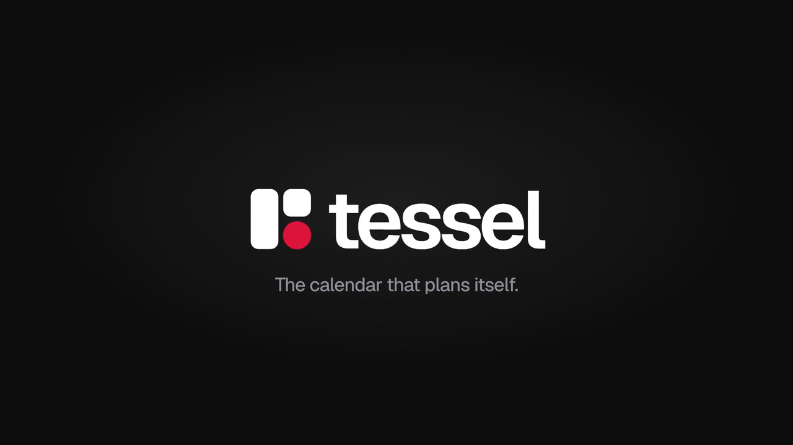](works/tessel/README.md)

**[Tessel · 33秒非官方复刻](works/tessel/README.md)** — 原作 Leonxlnx，保留MIT/OFL条款；完整源码恢复已验证、用户已决定收录。视觉 `PARTIAL`、实际听审 `NOT_LISTENED`、声画同步 `NUMERIC_ONLY` 分列，详见作品说明。此处复用该作品唯一封面，不另存缩略图。

[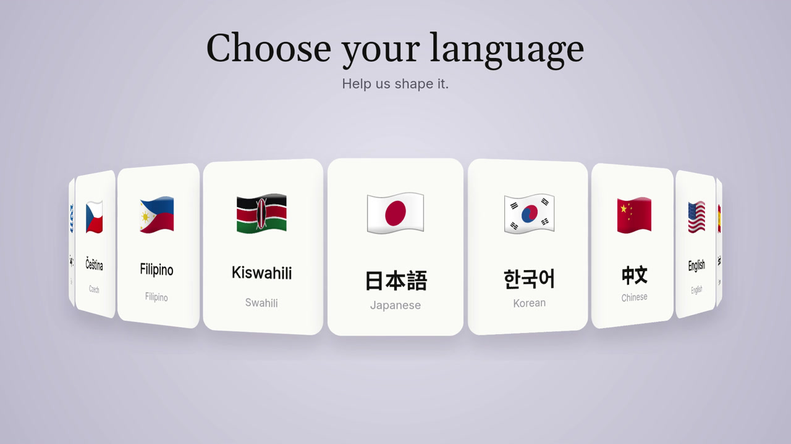](works/favorite52/README.md)

[Favorite52 · 52 秒原样复刻源码](works/favorite52/README.md) — `source-release`：16 项资源逐项列出；图标/混音及精确字体由用户合法自备。公开入口在自备资源下完成全长验证，与喜欢的影片逐字节相同；不含这些外置素材的再分发授权。

[](works/vinyl-study/README.md)

[黑胶商店 · 完整静态UI工程](works/vinyl-study/README.md) — `source-release`，1200×750固定画幅，完整Native绘制代码；9项字体外置自备并保留OFL条款，单帧重渲染已验证。非官方Huashu设计样例复刻；局部字形/纸纹残差披露，不冒充视频或响应式验证。

静态UI使用schema 4：render仅入口/宽高、cover为rendered-static且frame=null，验收不含听审/声画字段；仍要求完成、收录、恢复、技术和视觉状态。

[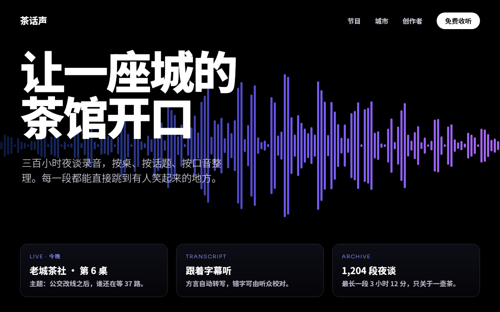](works/tea-voice-study/README.md)

[茶话声 · 完整声音品牌首屏](works/tea-voice-study/README.md) — 1200×750完整Native静态工程，以巨型中文标题、贯穿声波及近黑信息层级表达城市声音。非官方Huashu标本复刻；字体外置且双重SHA校验，源码恢复已验证。150柱移植源SVG，非真实录音频谱；保留局部字体与正文叠波残差，不冒称视频、声音或交互已验收。

[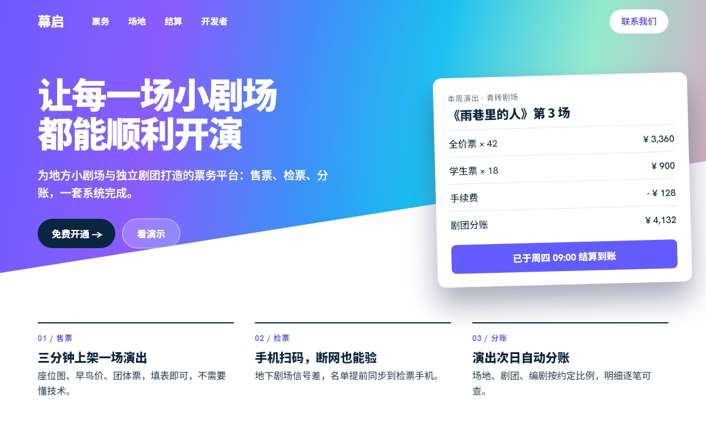](works/muqi-study/README.md)

[幕启 · 地方剧场品牌首屏](works/muqi-study/README.md) — 1200×750完整静态学习复刻，完整可编辑源码、设计逻辑、许可与外置字体准备随项目保留。单帧重渲染匹配已审画面；非官方Huashu标本复刻，视觉仍保留PARTIAL残差，未验证浏览器/交互/动效。

[](works/cycling-year-report/README.md)

[骑行年报 · Y2K演示页](works/cycling-year-report/README.md) — 1200×750完整静态学习复刻，完整可编辑源码、设计逻辑、许可与外置字体准备随项目保留。单帧重渲染匹配已审画面；非官方Huashu标本复刻，视觉仍保留PARTIAL残差，未验证浏览器/交互/动效。这是演示画面，不计为完整产品UI。

[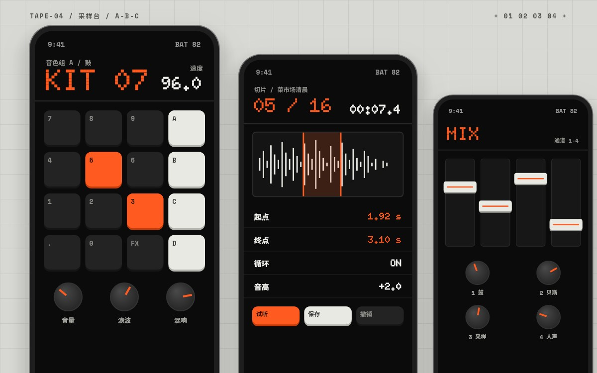](works/hardware-sampler-study/README.md)

[采样台 · 硬件面板三屏展示](works/hardware-sampler-study/README.md) — 1200×750完整静态学习复刻，完整可编辑源码、设计逻辑、许可与外置字体准备随项目保留。单帧重渲染匹配已审画面；非官方Huashu标本复刻，视觉仍保留PARTIAL残差，未验证浏览器/交互/动效。

[](works/shanghai-deco-study/README.md)

[摩登焙香 · 装饰艺术月历](works/shanghai-deco-study/README.md) — 1200×750完整静态学习复刻，完整可编辑源码、设计逻辑、许可与外置字体准备随项目保留。单帧重渲染匹配已审画面；非官方Huashu标本复刻，视觉仍保留PARTIAL残差，未验证浏览器/交互/动效。

静态作品按各自README在独立Node进程中渲染；不要把多个作品的字体注册与场景合并到同一全局渲染器。这些是完整作品工程，不是已验证任意混用的通用组件。

## Huashu B02 · 字体、信息叙事与透明材质

[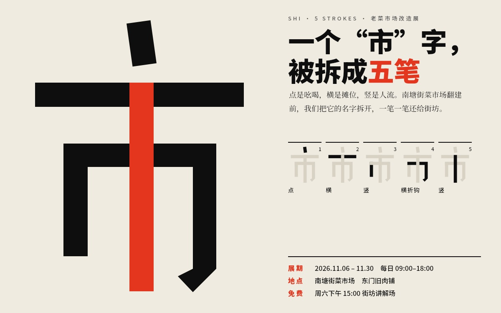](works/hanzi-poster-study/README.md)

[市 · 汉字实验海报](works/hanzi-poster-study/README.md) — 汉字海报，以字形与笔画关系叙事，不算完整产品UI。 完整可编辑静态工程与设计逻辑、许可、字体准备保留；重渲染匹配已审画面，残差仍按PARTIAL披露，未验证交互或视频。

[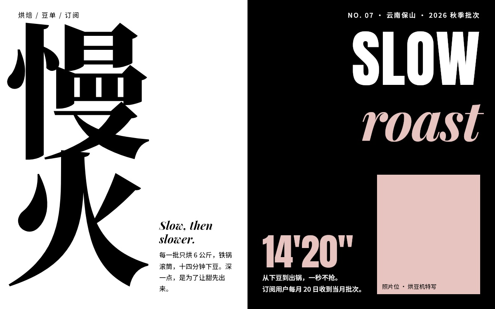](works/slow-roast-study/README.md)

[慢火 · 咖啡品牌编辑式首屏](works/slow-roast-study/README.md) — 咖啡品牌首屏；摄影区是原样例占位，工艺数值仅为样例，不冒充真实产品依据。 完整可编辑静态工程与设计逻辑、许可、字体准备保留；重渲染匹配已审画面，残差仍按PARTIAL披露，未验证交互或视频。

[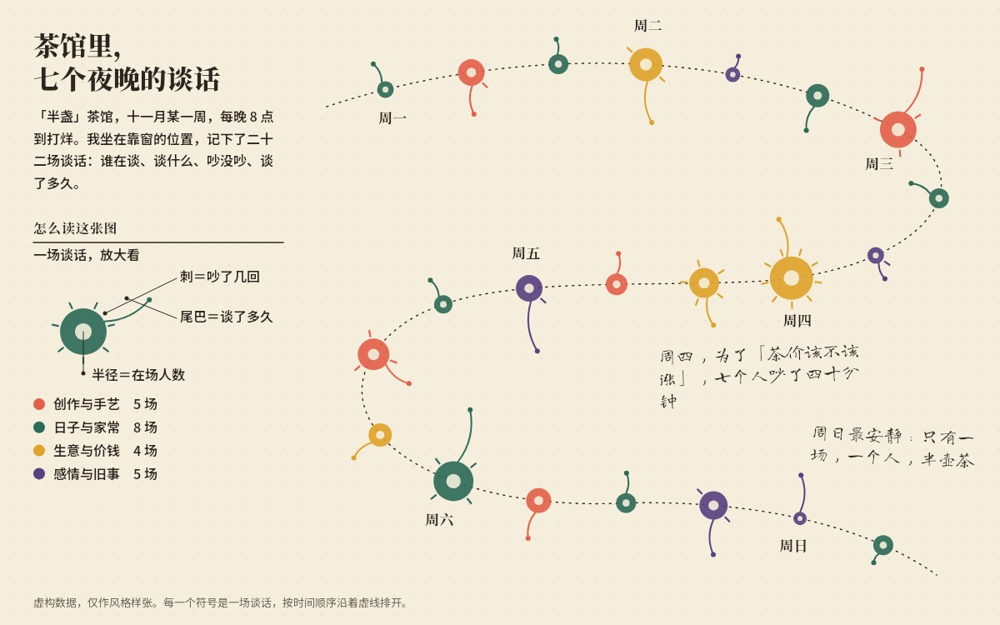](works/tea-conversation-map/README.md)

[数据人文 · 茶馆一周对话地图](works/tea-conversation-map/README.md) — 数据人文演示画面，原作周日旁注与符号数量矛盾已披露，不算完整产品UI。 完整可编辑静态工程与设计逻辑、许可、字体准备保留；重渲染匹配已审画面，残差仍按PARTIAL披露，未验证交互或视频。

[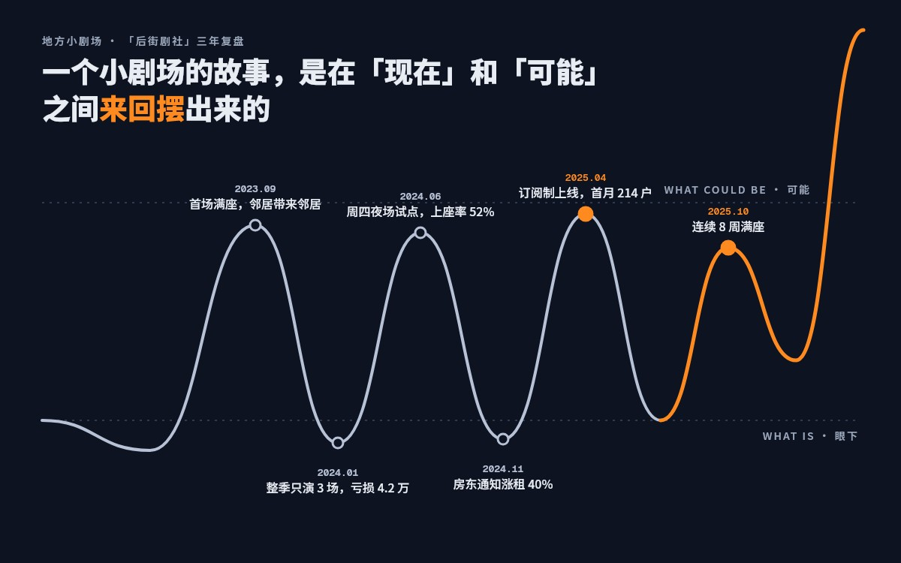](works/theatre-narrative-wave/README.md)

[叙事曲线 · 剧场现实与可能](works/theatre-narrative-wave/README.md) — 曲线用作现实与可能的叙事隐喻，不是量化趋势或真实统计。 完整可编辑静态工程与设计逻辑、许可、字体准备保留；重渲染匹配已审画面，残差仍按PARTIAL披露，未验证交互或视频。

[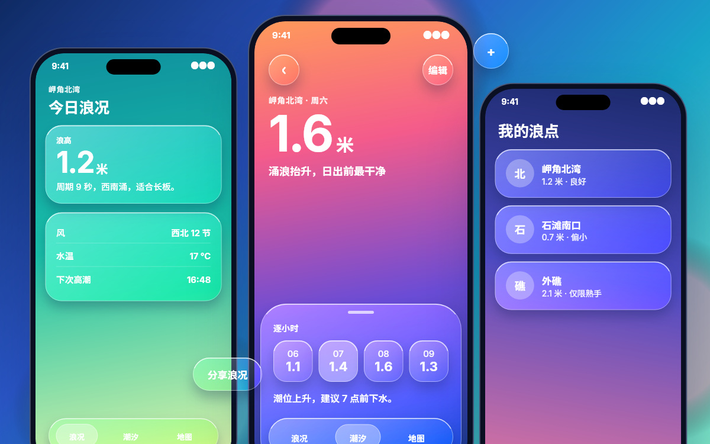](works/liquid-glass-study/README.md)

[液态玻璃 · 冲浪预报三屏展示](works/liquid-glass-study/README.md) — 完整三屏展示；自产画布透色与alpha柔影为2D近似，不宣称物理折射或苹果官方设计。 完整可编辑静态工程与设计逻辑、许可、字体准备保留；重渲染匹配已审画面，残差仍按PARTIAL披露，未验证交互或视频。


## Huashu B03 · 天文编辑、专业控制与视觉叙事

[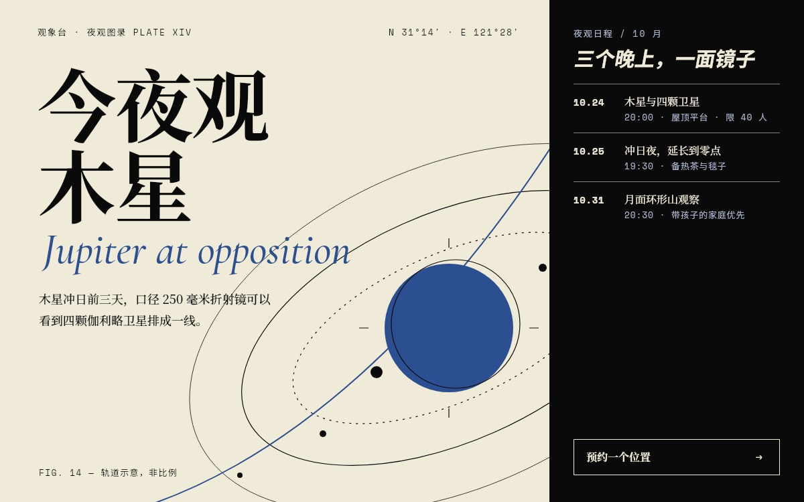](works/cosmic-observatory-study/README.md)

[今夜观木星 · 复古未来观象台](works/cosmic-observatory-study/README.md) — 1200×750。复古编辑式天文品牌首屏；轨道非比例，观测日期和科学说法未经事实核查。 完整工程独立重渲染匹配已审帧，视觉残差仍按PARTIAL披露；未验证浏览器、交互或视频。

[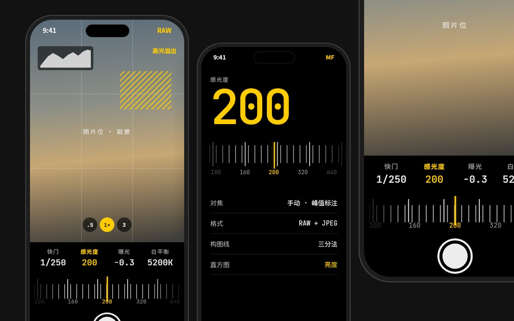](works/pro-camera-study/README.md)

[专业相机 · 参数控制三屏](works/pro-camera-study/README.md) — 1200×750。专业相机三屏静态展示；渐变是原样例照片占位，非真实摄影或可操作相机。 完整工程独立重渲染匹配已审帧，视觉残差仍按PARTIAL披露；未验证浏览器、交互或视频。

[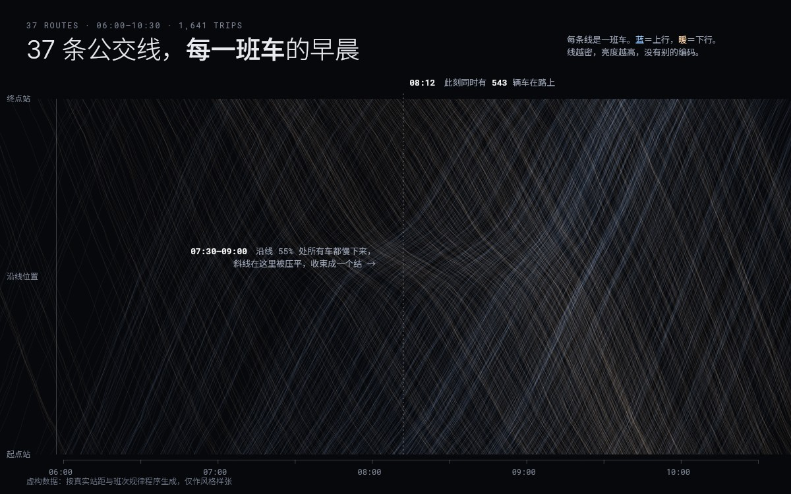](works/bus-morning-study/README.md)

[公交早晨 · 计算式数据肖像](works/bus-morning-study/README.md) — 1200×750。信息设计的密线数据肖像，不是完整产品UI；虚构模型保留37路线未建模及543/538、1641/1640计数差异。 完整工程独立重渲染匹配已审帧，视觉残差仍按PARTIAL披露；未验证浏览器、交互或视频。

[](works/wave-weather-study/README.md)

[今天的浪 · 玩味错位天气海报](works/wave-weather-study/README.md) — 1200×750。错印波浪与天气读数的完整静态画面，数据只是样例，不用于冲浪安全决策。 完整工程独立重渲染匹配已审帧，视觉残差仍按PARTIAL披露；未验证浏览器、交互或视频。

[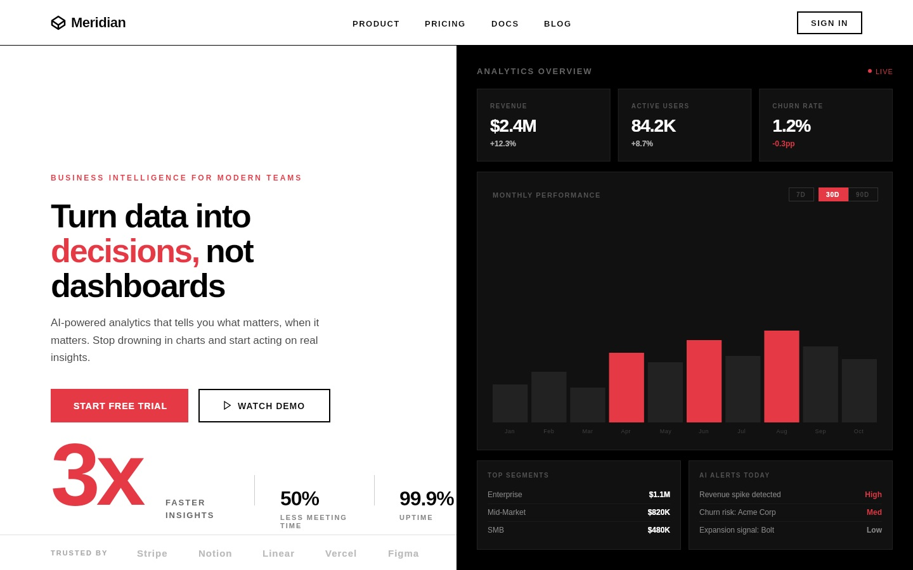](works/meridian-study/README.md)

[Meridian · 黑白对分品牌与产品首屏](works/meridian-study/README.md) — 1440×900。黑白对分的SaaS品牌首屏；非Pentagram官方作品，样例客户/数据不构成背书，原图低对比问题保留。 完整工程独立重渲染匹配已审帧，视觉残差仍按PARTIAL披露；未验证浏览器、交互或视频。


## Huashu B04 · 街招、像素路线与信息结构

[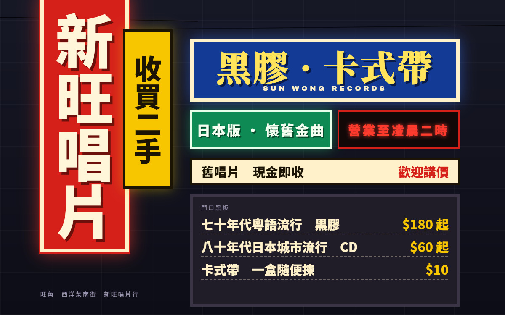](works/hk-street-signs-study/README.md)

[新旺唱片 · 港式街招](works/hk-street-signs-study/README.md) — 1200×750。香港街招品牌视觉；店名、营业时间与价目为源样例，无真实经营背书。 完整工程独立重渲染匹配已审帧，视觉残差仍按PARTIAL披露；未验证浏览器、交互或视频。

[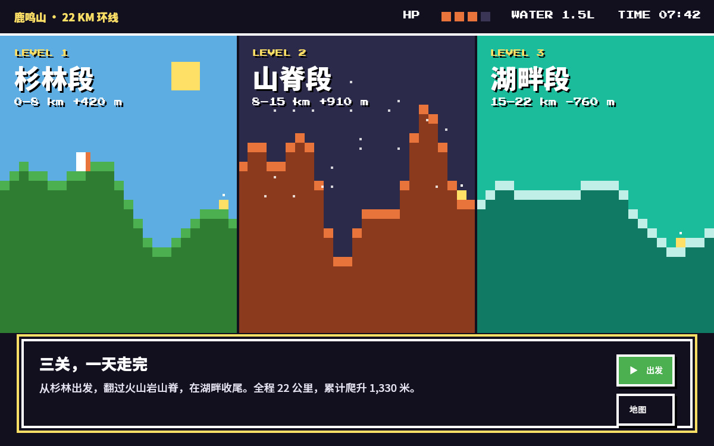](works/pixel-hiking-study/README.md)

[鹿鸣山 · 像素徒步三关](works/pixel-hiking-study/README.md) — 1200×750。三段像素徒步首屏；地形不按地理比例，里程、爬升、水量均为样例，非登山指南或可玩游戏。 完整工程独立重渲染匹配已审帧，视觉残差仍按PARTIAL披露；未验证浏览器、交互或视频。

[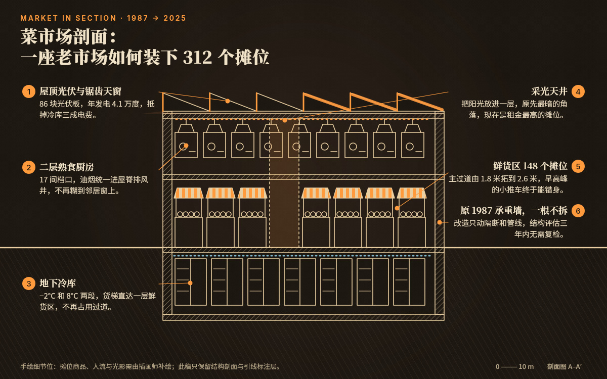](works/market-section-study/README.md)

[菜市场剖面 · 完整静态复刻](works/market-section-study/README.md) — 1200×750。建筑剖面信息图；只复刻原作结构线和引线层，不补造商品人流，面积/工程数据未经核实。 完整工程独立重渲染匹配已审帧，视觉残差仍按PARTIAL披露；未验证浏览器、交互或视频。

[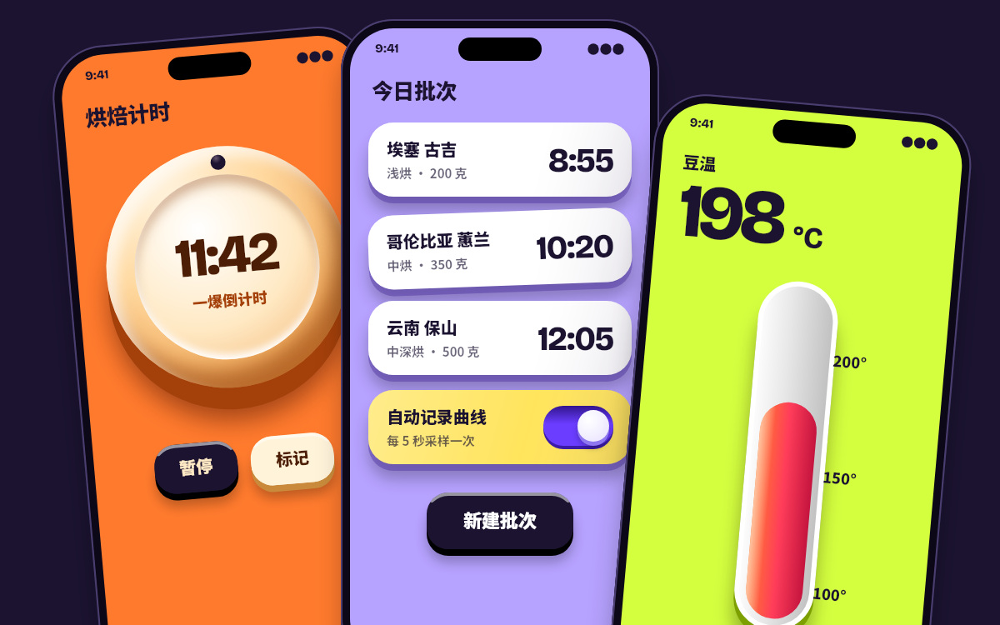](works/playful-roast-timer-study/README.md)

[烘焙计时 · 完整静态复刻](works/playful-roast-timer-study/README.md) — 1200×750。玩味材质烘焙三屏；时间、温度、豆种和重量仅为例文，不构成工艺建议；已调用材质表面积木。 完整工程独立重渲染匹配已审帧，视觉残差仍按PARTIAL披露；未验证浏览器、交互或视频。

[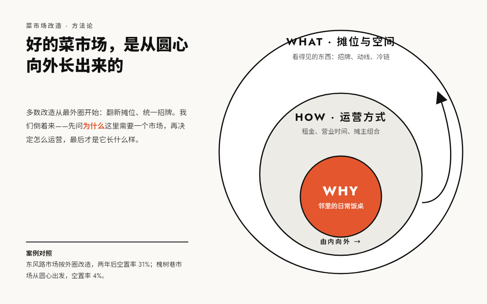](works/market-method-study/README.md)

[菜市场方法论 · 从圆心向外](works/market-method-study/README.md) — 1200×750。方法论单页演示；偏心嵌套圆表达目的与机制，不作统计面积，市场数据与因果主张未经核实。 完整工程独立重渲染匹配已审帧，视觉残差仍按PARTIAL披露；未验证浏览器、交互或视频。


## Huashu B05 · 宋刻、几何剧场与数据语义

[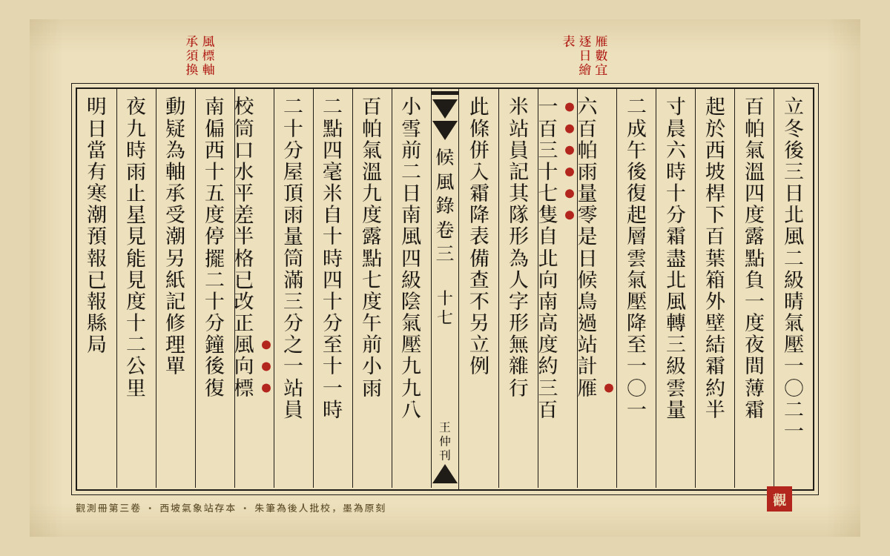](works/song-block-print-study/README.md)

[候風錄 · 宋刻版式](works/song-block-print-study/README.md) — 1200×750。宋刻版式完整画面；竖排阅读与朱批为设计样例，不冒充历史真本或真实气象记录。 完整工程独立重渲染匹配已审帧，视觉残差仍按PARTIAL披露；未验证浏览器、交互或视频。

[](works/bauhaus-theatre-study/README.md)

[河湾小剧场 · 三出戏一个舞台](works/bauhaus-theatre-study/README.md) — 1200×750。几何剧场品牌首屏；图形与节目身份对应，价格/日期仅样例，非真实售票或官方包豪斯作品。 完整工程独立重渲染匹配已审帧，视觉残差仍按PARTIAL披露；未验证浏览器、交互或视频。

[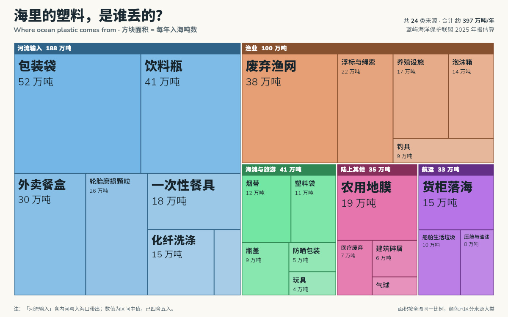](works/ocean-plastic-treemap-study/README.md)

[海里的塑料 · 完整静态复刻](works/ocean-plastic-treemap-study/README.md) — 1200×750。海洋塑料信息图；源块面积非严格同一比例，吨数与机构仅原作例文，无统计证据背书。 完整工程独立重渲染匹配已审帧，视觉残差仍按PARTIAL披露；未验证浏览器、交互或视频。

[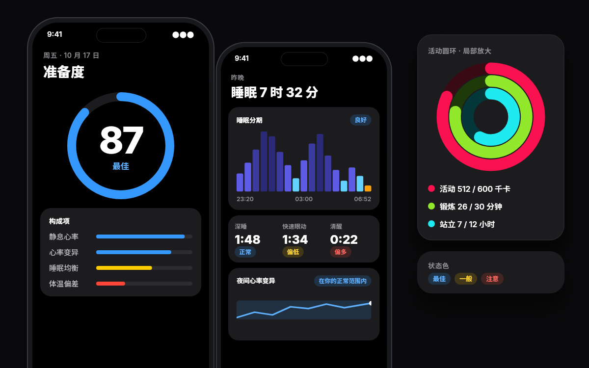](works/health-color-code-study/README.md)

[健康数据颜色编码 · 完整静态复刻](works/health-color-code-study/README.md) — 1200×750。健康颜色编码三屏；弧长与标签比例存在源差异，健康数据仅UI示意，非医学结论。 完整工程独立重渲染匹配已审帧，视觉残差仍按PARTIAL披露；未验证浏览器、交互或视频。

[](works/irreverent-pop-study/README.md)

[反叛流行 · AI写的，别像AI](works/irreverent-pop-study/README.md) — 1200×750。反叛流行写作工具首屏；营销统计及模型断言未经核实，不代表GPT或OpenAI性能宣传。 完整工程独立重渲染匹配已审帧，视觉残差仍按PARTIAL披露；未验证浏览器、交互或视频。

## Huashu B06 · 出版导航、空间编码与年度叙事

[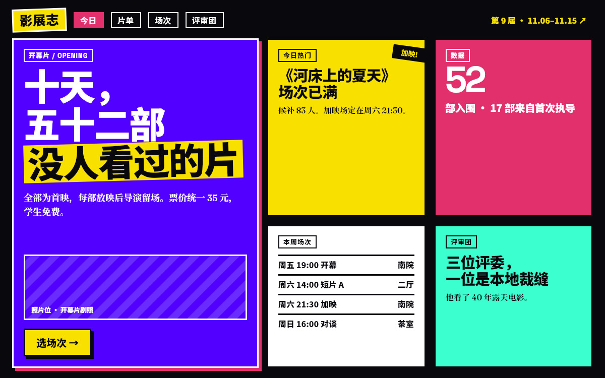](works/film-festival-study/README.md)

[影展志 · 十天五十二部](works/film-festival-study/README.md) — 1200×750固定静态设计标本，完整可编辑源码、外置字体双重校验、独立重渲染与统一设计卡保留；实际公共族调用及案例内配方见retention.json，未升级配方为新通用族。原样例内容与残差按PARTIAL披露，不代表真实业务数据或浏览器/动效验收。

[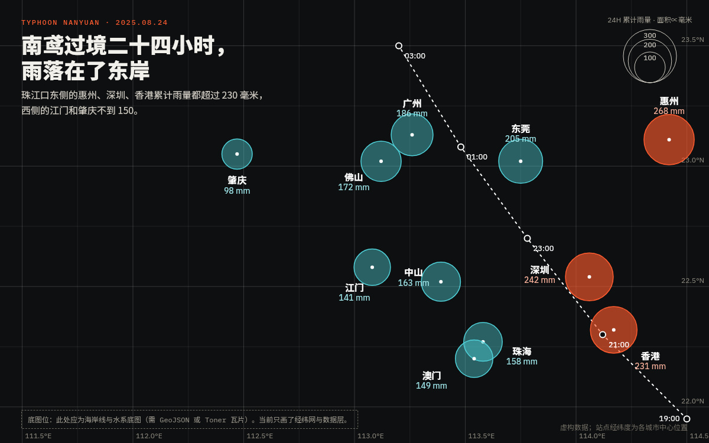](works/nanyuan-cartographic-study/README.md)

[南鸢过境 · 完整静态复刻](works/nanyuan-cartographic-study/README.md) — 1200×750固定静态设计标本，完整可编辑源码、外置字体双重校验、独立重渲染与统一设计卡保留；实际公共族调用及案例内配方见retention.json，未升级配方为新通用族。原样例内容与残差按PARTIAL披露，不代表真实业务数据或浏览器/动效验收。

[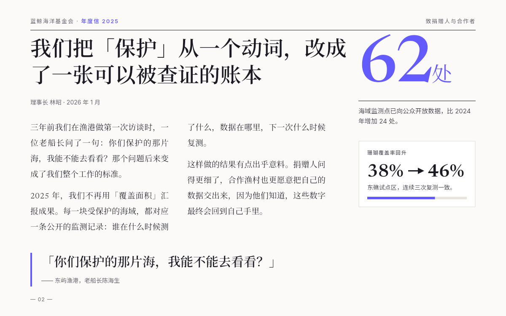](works/ocean-letter-study/README.md)

[海洋基金年度信 · 编辑式长文](works/ocean-letter-study/README.md) — 1200×750固定静态设计标本，完整可编辑源码、外置字体双重校验、独立重渲染与统一设计卡保留；实际公共族调用及案例内配方见retention.json，未升级配方为新通用族。原样例内容与残差按PARTIAL披露，不代表真实业务数据或浏览器/动效验收。

[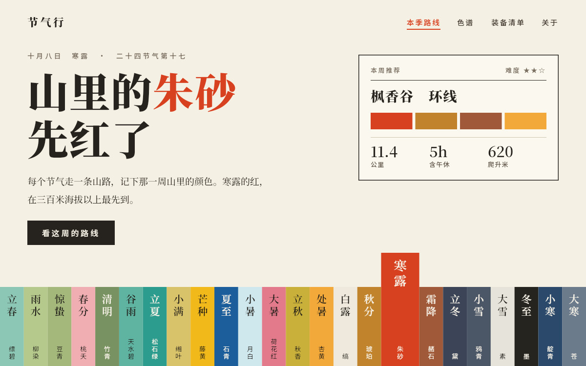](works/solar-terms-study/README.md)

[节气行 · 山里的朱砂](works/solar-terms-study/README.md) — 1200×750固定静态设计标本，完整可编辑源码、外置字体双重校验、独立重渲染与统一设计卡保留；实际公共族调用及案例内配方见retention.json，未升级配方为新通用族。原样例内容与残差按PARTIAL披露，不代表真实业务数据或浏览器/动效验收。

[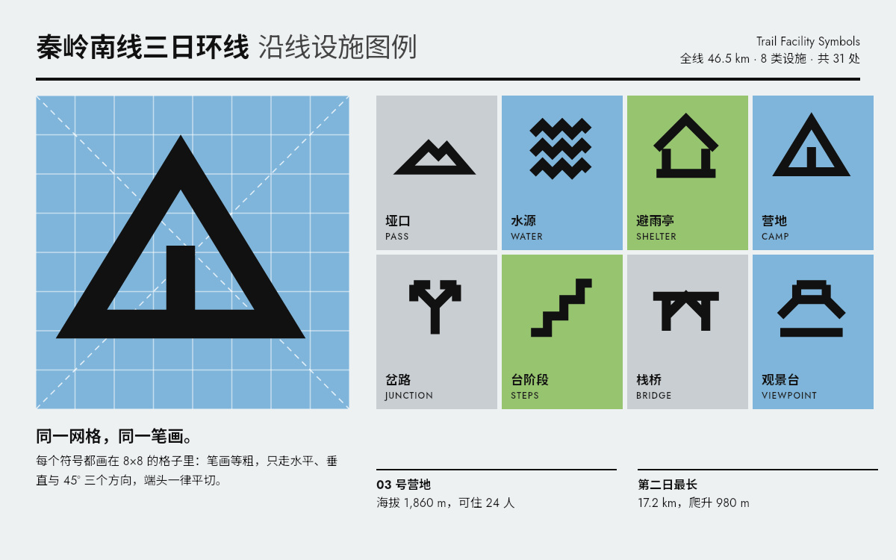](works/trail-pictogram-study/README.md)

[沿线设施图例 · 完整静态复刻](works/trail-pictogram-study/README.md) — 1200×750固定静态设计标本，完整可编辑源码、外置字体双重校验、独立重渲染与统一设计卡保留；实际公共族调用及案例内配方见retention.json，未升级配方为新通用族。原样例内容与残差按PARTIAL披露，不代表真实业务数据或浏览器/动效验收。

## 最小结构

```text
portfolio/
  README.md                 # 范围与使用方式
  validate.py               # Python 标准库：离线静态检查，不下载、不执行作品
  test_validate.py          # 合成夹具，不是作品
  works/<作品-id>/          # 仅在全部准入门完成后创建
    README.md               # 原作者 / 原作链接 / 非官方复刻说明 / 一条重渲染命令
    CREDITS.md              # 来源、修改、权利边界；随渲染结果一同交付
    cover.jpg               # 唯一封面，绑定获准版本；逐文件hash白名单
    LICENSES/              # 实际使用的 MIT / OFL / CC 等完整条款及版权
    entry.json             # 帧/采样合同、资源身份、许可、源码hash、依赖锁
    src/                   # 绘制、编排、字体/素材生成与声音合成的必要代码
    locks/                 # 真正生成并验证过的依赖锁，不是观察版本冒充锁
```

复用仓库 `engine/` 和渲染入口，不复制整套引擎、研究历史或 node_modules。依赖从实际 import/执行路径计算；不要为作品集增加浏览器、React、3D 引擎或评审服务，除非作品确实需要。

## 准入与权利

1. 全长作品已经完成、获得明确保留决定，且完整技术恢复通过。用户收录决定与逐项评审分开：技术测试、连续视觉、真实听审、感知声画同步各有真实状态和覆盖范围。明确披露 `NOT_LISTENED` 等未执行项目可以收录；不得为了通过校验填成已听审、扩大用户肯定的范围或泛称所有评审通过。检查工具不会替人完成这些判断。
2. 原作者姓名、原作链接、版权和**非官方复刻版，不代表原作者/品牌背书**必须出现在作品 README/CREDITS 中。原作不是自己原创；仓库 MIT 不自动覆盖原作、品牌、照片、字体或音乐。
3. 对实际分发或自动取得的资源必须有适用明确许可，保留完整 MIT/OFL/CC 条款、版权、署名及改动说明。外置但权利未闭环的资源可列为 `provide`，只提供出处、身份和合法自备说明，不打包、不自动下载、不暗示许可已齐。仅公开可见、能下载、用户喜欢或有 hash 都不是授权。
4. 字体衍生遵循各自许可（包括适用的保留名称要求）；不得将所有字体笼统标成 OFL。没有许可的品牌图标或临摹素材不能通过“改成代码”解除权利问题。
5. 只提交必要源码/文本配置/许可和唯一获准封面。**不提交**原视频、成片、帧序列、字体二进制、除唯一封面外的图片、音频、归档、缓存、依赖安装目录、密钥、私有路径、Library ID、私人反馈或授权函中的个人数据。
6. 输出和资源缓存必须在仓库外；不要为纳入某件作品而削弱根源码检查、改写历史或清理私人恢复包。新增作品发布前，明确同步根 `SOURCE-SCOPE.md` 与 `THIRD_PARTY_NOTICES.md` 的公开边界。

## 非商业用途与权利人联系下架

本作品集由维护者用于**学习、研究与非商业展示，不用于商业目的**。其中的复刻不是官方版本，不代表原作者、品牌或权利人认可、参与或背书。原作者及其他权利人的权益应受到尊重。

**如您为原作者或相关权利人，认为本作品集的内容涉及侵权，请联系我们；我们将及时核查并在确认需要处理时下架或删除相关公开内容。**

- 公开权利联系渠道：通过 [MotionStudio GitHub Issues](https://github.com/doomclouds/MotionStudio/issues) 联系维护者，可在 Issue 中注明「权利人通知 / 下架请求」及相关公开文件链接。Issue 是公开渠道，请勿提交身份证件、私人合同、私人邮箱或电话号码等敏感资料；维护者也不得自动公开用户的个人信息。
- 通知宜包含：争议作品/文件的公开链接、所主张的原作或权利来源、需处理的具体内容及可回复渠道。仅收集核查所必需的信息，不将通知人的私人材料写进公开仓库。
- 处理流程：接收并回复通知 → 核对具体对象及权利依据；存在合理疑虑时先暂停相关内容的公开展示/获取 → 依据核查结果及时下架、删除、更正署名或补充许可 → 告知处理结果并复核公开页面、封面、获取链接及发行包是否仍提供相关内容。争议未解决前不重新上架。
- 下架处理以相关**公开内容**为范围，不擅自删除私人恢复包或改写 Git 历史。若历史、缓存或既有发行包仍可取得该内容，须标明残留位置，交维护者确认必要清理措施；不能把删掉当前页面说成已经彻底删除。

**“非商业用途”“如侵权请联系删除”都不是授权，也不能使未经许可的使用自动合法。** 不因加入本声明而放宽前述来源、许可及发布审核门。

上述非商业声明描述的是**维护者使用和展示本作品集的目的**，不是新的非商业许可证，也不改写或收窄本仓库及上游代码已授予的 MIT 等许可；依许可享有的权利仍按各自条款执行。字体、音乐、照片及其他资源同样适用各自许可，完整条款、版权和署名要求继续保留；软件许可不自动覆盖第三方素材、商标或其他权利。

## 外置资源与声音

优先保留确定性生成代码和 cue 配置。不能源码生成的必要资源，只保留来源、适用许可、署名和固定 SHA-256。资源准备与渲染分开：默认离线；用户显式准备资源时才允许按经过核实的许可下载。

下载必须 HTTPS、无令牌/私人签名 URL、限定原始来源/允许的重定向主机、大小上限、超时、临时文件原子改名并核对 hash；不自动执行下载物、不抓取登录流、不用搜索结果替换文件。离线缺失、404、重定向越界、hash 不符都应明确失败，并指出合法手动取得后应放的位置；不得悄悄换曲、换字体、静音或降级。命中缓存也重新验 hash。

完整声音还原需要 BGM 编辑、SFX 合成及混音时间线；只有一条已混音 AAC，或只有音乐网页，并不等于可从源码复现。若合成替代有声差异，必须作为新变体说明，不能覆盖原版本。

实际作品有各自的资源准备器。只有明确许可和固定来源/hash 就绪的项目才允许显式联网；`provide` 项目只接受合法自备文件，必须测试缺失/hash 错误和路径逃逸。

`schema: 3` / `status: source-release` 表示**源码已经正式收录，但原样运行有明确的外置自备资源条件**，不是失败候选或“无需自备资源”承诺。每个 `provide` 项必须列出本地相对路径、字节数、SHA-256、来源链接、真实许可边界和供给说明，`permission` 固定为 `user-supplied-not-distributed`；不得借此对未许可素材自动下载、打包或静默替换。`clean_restore` 只证明所披露的自备资源条件下完整技术恢复实际通过，不证明资源所有权利已解决。v1/v2 仍保留原规则，不放宽其自动取得授权要求。

## 每部作品只留一张封面

- 由维护者挑选最能表达本片主要机制、主体清晰、缩小后仍能辨识的**一帧**；不默认挑最热闹或模糊最重的瞬间。不附额外缩略图、接触表、封面历史或原作截图。
- 首选已完成并获准版本的复刻成片原生帧，绑定最终成片 SHA-256 与整数帧号。不是直接引用原作者源片帧，也不是未完成候选的截图。可用独立原创且可公开的封面，但须记录其作者、生成/制作来源与权利，并明确它不是成片像素证据。
- 固定名称 `works/<id>/cover.jpg`，**至多且发布时恰好一张**，不超过 1 MiB，默认保持成片画幅。去除 EXIF/IPTC/XMP/位置等元数据；实际打开检查清晰度、裁切、颜色和可读性。
- 封面本身要有可公开权利，继承并保留作品和相关第三方的声明。用户授权选择封面，不等于授权使用未清权的原作、人物、品牌或音乐。
- 源码树检查仍生效。每张封面在根 `scripts/source-assets-allowlist.json` 中以**精确路径 + SHA-256**单独批准，同时更新其边界说明；不能用通配符一次允许所有 JPG/PNG。本目录的忽略例外不等于白名单审批。
- **不生成占位封面、不纳入任何原作帧**。只有全片完成、明确获准收录且权利/恢复检查通过后再选封面；未入库的原版本与恢复包继续原地保留。

## 检查与复现分层

```sh
python3 portfolio/validate.py
python3 -m unittest discover -s portfolio -p 'test_*.py'
```

静态检查检查格式、源码hash、路径/媒体边界和声明是否完整；通过不证明法律结论、成功渲染或审美通过。空作品集会显式显示 `0 released works`，不把规范或测试夹具计为作品。

入库前必须完成：全新外置目录离线恢复、代表帧顺序/乱序/重开一致性、完整渲染、FFprobe 帧率/帧数/采样合同、全量解码和最终封装音轨检查。正常速度视觉、真实听审及感知声画同步按实际执行情况单独记录；缺项须在作品README与manifest明确披露，联系表/数值同步不能变成完整观看/听审。所有结果绑定同一版源码与成片 hash。依赖锁、系统运行时版本/平台、字体转换版本都记录；没有新平台复验就不宣称跨平台像素或 MP4 字节相同。

## 附录：entry.json v2（兼容v1）

一个 manifest 对应一个**完整已发布**作品。候选/受阻作品留在外部工作区，不能用 manifest 的布尔值代替真实审查。字段不能包含私有路径、下载令牌、Library ID 或私人评语。`validate.py` 是本版本的可执行静态合同；不执行任意渲染命令、不联网、不验证法律效力。

必填结构：

- `schema`: 新条目使用 `2`；`id`: 与作品目录同名的小写连字符标识；`version`: 精确 `major.minor.patch`；`title`: 非空文字；`status`: `released`。
- `unofficial_recreation`: `true`；`original`: `{author, title, url}`。`url` 是不含认证信息的公开 HTTPS 原作页面。此合同专用于非官方复刻作品，不把原创强行伪装成复刻。
- `rights`: `{status: "reviewed", credits: "CREDITS.md", notices: ["LICENSES/…"], evidence_urls: ["https://…"]}`。人工已经核对适用范围才可写 reviewed，证据须公开可核；未核/不明确不可发布。完整条款和版权必须在对应 notice 中。
- `files`: `[{path, sha256, role}]`。列出目录内除 `entry.json` 外的**全部**文件，路径相对作品根；role 为 `source` / `config` / `documentation` / `license` / `lock` / `cover`。固定 SHA-256 来自实际字节，不填占位符。不准 symlink、绝对路径、`..`、隐藏运行数据或除唯一封面外的媒体。
- `runtime`: `[{name, version, lock}]`。每个真正使用的外部运行时/依赖给出精确观察版本与在 files 中 role=lock 的文件；锁文件可区分安装锁与平台版本约束。运行时版本报告不是 npm/pip 锁，不能谎称供应链完全锁定。仓库内共享引擎源码应在锁中列出固定提交及源文件hash。
- `render`: `{entrypoint, frames, width, height, fps_num, fps_den, audio_sample_rate, audio_channels}`。entrypoint 在 files 中 role=source；数字都是正整数；时长由 `frames * fps_den / fps_num` 推出，不使用浮点歧义。README 提供完整实际命令，输出只写仓库外。
- `resources`: 零个或多个 `{id, mode, license, notice, source_url, sha256, ...}`。`license` 是明确许可名/标识，不能写 unknown；notice 对应 files 中 role=license。source_url 给出公开来源；sha256 是最终输入字节身份。
  - `mode: "fetch"` 另需 `fetch_url`（无凭证的公开 HTTPS 资源 URL）、`permission: "explicit-license"`、`max_bytes`（正整数）。这只是经核实授权声明，校验器不会下载。
  - `mode: "generate"` 另需 `generator`（已列出的 source）、`permission: "explicit-license"`。生成代码与输入仍需许可；生成字节 hash 不意味着声音听审通过。
- `cover`: `{path: "cover.jpg", kind: "rendered-frame" | "original-artwork", source_sha256, frame, rights_status: "reviewed", credit: "CREDITS.md"}`。path 在 files 中唯一 role=cover。成片帧绑定最终影片 SHA-256，frame 为 `[0,frames)` 的整数；原创封面 frame 为 null，source_sha256 绑定原始原创输入/制作结果，CREDITS 交代作者和来源。封面自身 SHA-256 在 files 中。静态检查只查 JPEG 结构头/尺寸/显式元数据和字节身份，不替代完整解码/实际查看/权利核实。
- `acceptance`: `complete_work`、`owner_keep`、`clean_restore`、`technical` 必须各为 `true`，对应全片完成、用户保留决定、真实完整恢复、技术合同通过。`visual`、`listened`、`av_sync` 各为 `{status, coverage}`，`coverage` 为非空的实际检查范围与未做项目说明：
  - `visual.status`: `PASSED` / `PARTIAL` / `NOT_REVIEWED`；只查看联系表、抽帧或比较像素不能伪装成正常速度完整观看。
  - `listened.status`: `PASSED` / `NOT_LISTENED`；没有实际听审就必须明确后者，不以波形、相关性或用户笼统肯定替代。
  - `av_sync.status`: `PASSED` / `NUMERIC_ONLY` / `NOT_REVIEWED`；仅PTS、样本数量或相关性检查使用 `NUMERIC_ONLY`，不声称感知同步通过。
  - 这些仍是人工维护的声明，不是静态检查结论；实际证据保留外置，发布评审核实。用户全片保留/上传决定可以支持收录，但不扩大成逐项观看/听审。不得以8秒片段认可代替33秒全片。

兼容旧 `schema: 1` 的七个布尔字段仍要求全部为 `true`，不会自动把布尔值解释成v2状态；没有真实逐项审查的新作品必须使用v2，禁止用假 `true` 通过旧合同。

最小依赖不是零依赖承诺。准备脚本不得以 `curl | bash`、安装时任意脚本或默认在线下载规避锁。需要上游源码时固定 commit/blob 与 SHA-256，并保留 upstream notice；只用分支名不构成固定版本。下载的压缩包须检查路径穿越、symlink 和解压大小上限。

## 静态设计的沉淀结构与使用（2026-10修订）

[统一作品与积木关系索引](DESIGN-INDEX.md) / [机器索引](design-index.json)。这里的静态作品包括品牌首屏、海报、信息图、演示页及设备UI，不把它们统称为完整产品界面。完整作品、公共积木与方法卡分开计数。

**每个静态作品必须有 `DESIGN-RETENTION.md` 与 `retention.json`。** 不搬迁旧分析、场景或外置资源：统一卡连接旧分析和真实代码；`entry.json` 继续是文件完整性、固定画幅、运行入口、资源与验收的唯一权威。静态schema4和既有Motion schema2/3兼容，视频工程的src/、prepare/render入口、听审和声画验收不受此修订改变。

- 统一设计卡回答：内容与受众、品牌定位/语气（没有完整品牌系统就明说）、颜色职责/面积与对比、构图/字体/材料、可迁移规则与反例、代码调用和案例专用部分、审阅范围与后续视频边界。复刻来源、例文事实与残差须明确；不能只列颜色数值或赞美风格。
- `retention.json` schemaVersion=1：workId/kind/canvas/entrypoint映射作品；decisionCard/sourceAnalysis映射分析；ruleRefs只引用真实独立方法卡（空数组不等于没有设计思考）；assetUsage记录稳定familyId、runtime-import或vendored-snapshot、模块与来源commit/hash、调用点和可见职责；evidence指向entry验收和证据身份；motionTransfer保留NOT_TESTED，直到独立视频实验获得证据后另行扩展协议。
- 公共设计族的契约/文字/代码/配方在 `engine/design-elements/`；`catalog.json` 为公共族数量来源。源案例启发与真正调用严格区分。共享绘图工具、完整案例、函数、配方或模块快照都不新增族数。无合适模块就保留案例代码，不硬套。
- 运行时导入保留传递依赖锁；快照保留来源及SHA，不冒称自动跟随公共模块更新。先按作品README准备合法外置字体，再独立进程以固定尺寸运行，不能宣称克隆后无资源即可复现。
- 参考/复刻/局部对照、问题与修改、实际帧hash组成可视证据；公开目录的cover仅导航，不替代完整报告。当前比较包状态NOT_PUBLISHED如实保留。私人记录仅可发布经审查的非敏感记录ID/hash，绝不放本地绝对路径、私有链接或授权原文。PRIVATE_RECORD_LOCATED只表示定位记录，不代表公开可访问、审核全通过或本次重新渲染。
- 收藏、可再现、技术检查、视觉残差和公开许可分别管理。技术测试与像素差异不是审美评分；静态通过不是动效、交互、响应式或听审通过。源素材与完整报告公开仍需逐项权利范围审查。

维护命令（从仓库根运行）：

```sh
python portfolio/retention.py --write  # 仅重生成三份跨索引
python portfolio/retention.py --check  # 拒绝缺卡、假ID、调用/依赖错配与索引漂移
python portfolio/test_retention.py
python portfolio/validate.py          # 仍核对每作entry里的全部文件hash
python portfolio/test_validate.py
```

新增/改动每作文字或语义清单后，必须同步entry文件库存及SHA；保留旧作品帧与代码，不以整理之名重新设计。由catalog和全部静态作品sidecar生成的覆盖表不再手工维护。代码扫描验证只能确认显式模块/调用证据，不能证明像素贡献或审美：这些仍依赖独立可视审查。

使用顺序：先读内容任务与统一设计卡→比较适用/反例→从公共族契约选可用模块→按固定画幅构图→用实际参考与成品复核→用户决定收藏。新内容所需设计若未被现有模块表达，先保留专项并验证第二真实场景，再提取。未来视频迁移另验图层、注意力顺序、读时、运动及声音，不把复刻数量当审美提升。

### 只读检索全部静态作品

```sh
python portfolio/retention.py --query
python portfolio/retention.py --query --text 品牌
python portfolio/retention.py --query --text 像素 --family design.color-sections.v1
```

搜索作品ID、标题、统一设计卡与原分析全文，按字面子串匹配（不区分英文大小写），不搜索私人报告。`--family`必须是完整稳定ID，筛选真实调用而不是来源启发；与`--text`取交集。输出作品/卡路径、实际族、视觉和证据状态；不评分、排名或推定审美适用性。零匹配返回count=0，未知族或空白查询报错。无过滤条件列全部静态作品。只能在完整仓库使用，缺少仓库不能当成零结果；查询不写文件。

### 私有持久证据身份

归档核验后，可在evidence中新增 `visualReport`，而不覆盖原 `comparisonBundle` 的PNG/局部材料身份：状态仍NOT_PUBLISHED，记录非敏感opaque ID、HTML容器SHA、artifactKind=html-report、storage=PRIVATE_LIBRARY、durableStorage=ACCESS_VERIFIED，以及acceptedFrameBinding=EXACT_PIXELS或NOT_ESTABLISHED。独审原字节经私有Page回读验证后可将原独审记录升级为PRIVATE_OWNER_PAGE/ACCESS_VERIFIED；运行调用回执不能随之自动升级。

EXACT_PIXELS只表示报告嵌图与已审帧像素匹配，不代表新审美验收或浏览器预览通过。NOT_ESTABLISHED必须保留，尤其不能把有持久HTML报告说成已审原帧对照的完整闭环。公开库只保存受控记录ID/hash与状态，不公开Library/Page私有ID或URL。自动校验只检查记录契约与索引一致性，远端字节取回/解码与权限复核需另有实际执行证据。
