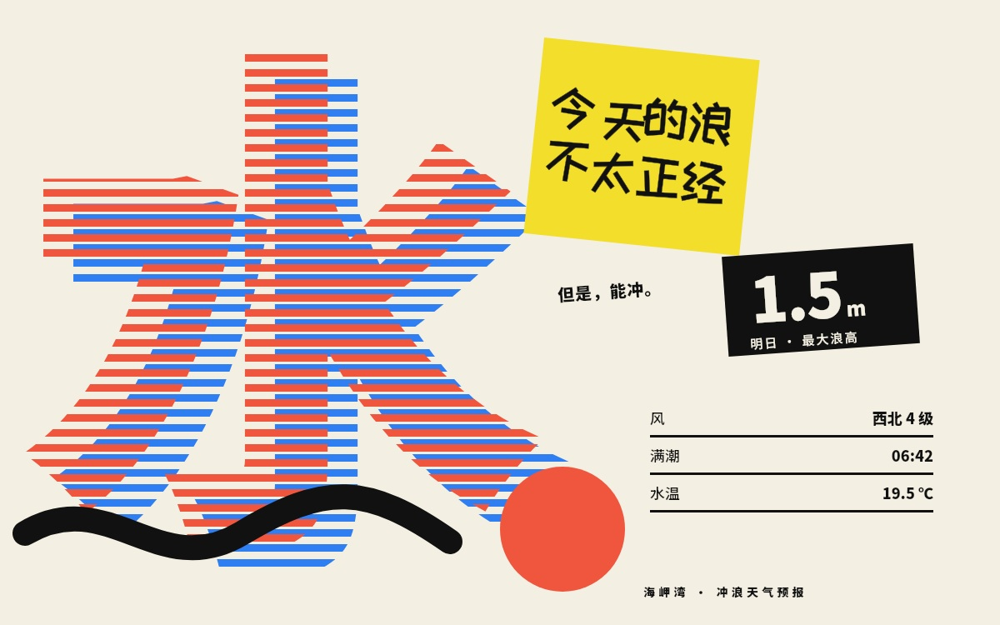

# 今天的浪 · 玩味错位天气海报

Complete fixed-frame Native Canvas study. [Pinned original](https://github.com/alchaincyf/huashu-design/blob/4fc7bfdbd5ec3fa2d43ce7a6433de60976a5e4b1/assets/style-specimens/east/10-hattori-playful-offset.html). 非官方复刻；Hattori只是样例风格标签，不代表服部一成官方作品；浪高/潮汐/温度均为未经核实的样例文案，不用于冲浪或出海决策。



Complete editable source: `design/scene.mjs`. [Design reasoning](DESIGN-REASONING.md) explains content, brand, composition, type, color and remaining limits. Only this rebuilt cover is bundled; no source screenshot, bitmap font or generated artwork.

## Restore and render

Use the existing MotionStudio Native core and its lock. Obtain licensed original inputs named NotoSansSC-variable.ttf, ZCOOLKuaiLe-Regular.ttf into an external directory, matching `font-inputs.json` SHA identities; family URLs and actual terms are in `entry.json`/`LICENSES`. Preparation verifies original inputs before writing; it verifies output font identities after derivation, and the render entry checks the same output hashes. Noto subsets use deterministic metadata. Use the pinned fonttools version in locks/runtime.json when preparing.

```sh
python prepare-fonts.py --font-dir /absolute/external-fonts
WAVE_FONT_DIR=/absolute/external-fonts node ENGINE/scripts/render.mjs --scene ABS/design/scene.mjs --work /absolute/new-output --frames 0
```

All fonts and generated files remain outside Git. Missing/wrong fonts fail closed. To change Chinese copy, extend font-charset.txt, reprepare and deliberately update output identities and visual regression; the existing identity contract intentionally does not silently accept changed fonts.

## Evidence and limits

Full frame and critical details were visually reviewed; user elected to retain the work. Complete entrypoints reproduced the retained Native frame. Visual status remains PARTIAL: JPEG/antialiasing and small text residuals remain. Static only: no browser, responsive, interaction, audio or Motion validation. Source claims and interface values are examples, not verified facts.
